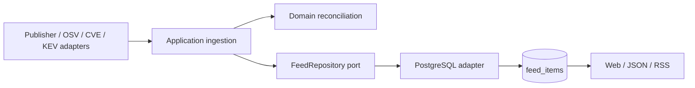

# Canonical feed architecture

The domain has two concepts: a `SourceRecord` is one publisher's current claim; a `FeedItem` combines compatible claims into one queryable item. Products, affected/fixed versions, CVEs, severity, fix availability, technology IDs and source URLs are ordinary columns. Native ranges, product/version associations, quotations and provider metadata are preserved in `records`.



`domain` imports no adapters, framework, environment variables or network functions. `application` coordinates work through `FeedRepository`, `IngestionQueue` and `SourceReader`. `server/services.ts` wires concrete adapters into those use cases. Next.js routes handle transport and invoke the composed services. Database SQL handles persistence, indexes, transactions and leases; grouping and risk classification live in TypeScript.

## Identity and changes

- A source claim is identified by source ID and canonical URL. Newer documents replace that claim. Stale workers cannot overwrite a newer completed document.
- Publisher patches combine only for the same source, exact normalized product set, and exact product/CVE fix relationships. Every relationship requires explicit remediation evidence and a documented fixed version. Dates and merely related CVEs are not grouping evidence. Fixed versions accumulate across matching release branches.
- OSV mirrors require an explicit GitHub advisory reference/alias, a reviewed GHSA anchor, and matching bounded native affected-package data. Shared CVEs alone never merge advisories across OSV, CVE and KEV or across products.
- Changes can split or merge items. Stable SHA-256 item IDs derive from their identity, independently of processing order. A retired identity remains as `active=false` with `replaced_by` pointers so clients can reconcile their local state. An active item may itself be a withdrawal; `active` means the identity is current.
- Withdrawn source claims stop contributing versions, CVEs and ratings. Reclassification as non-security publishes an explicit extraction correction when a prior security claim exists. It does not assert a publisher retraction.
- Semantic no-ops do not increment revisions or cursors. Document audit still records every completed extraction. Provider modification timestamps alone do not count as meaningful changes.

Severity and CVSS use only the item's current source records. KEV status comes from explicit source exploitation data. There is no transitive risk propagation through CVE joins. Optional `/api/v1/risk` enrichment remains separate; EPSS changes do not create feed revisions.

## Storage and consistency

`feed_items` is the only public read model. Browsing, filtering, full-text search, details and change polling query it directly. Technology suggestions enumerate its arrays; they are not a separately maintained catalog. Indexes cover cursors, common filters, source identities and full-text search.

For example, querying publisher patches needs no joins:

```sql
select id, title, product_names, fixed_versions, cve_ids
from feed_items
where active and kind = 'patch'
  and source_ids @> array['github-containerd-containerd']
order by cursor desc;
```

A publication transaction validates the document lease, locks publication order, loads potentially related items, runs pure reconciliation, upserts changed rows, and records the extraction result. Each changed row receives a new sequence cursor. The global transaction lock keeps commit order aligned with cursors; gaps from rollbacks are harmless. The adapter uses the same checked-out PostgreSQL connection for the complete transaction.

Private routing columns retain previous type, severity, CVE, technology, source, fix and importance matches so corrections reach subscribers. Free-text search describes current evidence and does not retain historic search terms. These columns are excluded from public JSON. There is no second stream of immutable group snapshots: change polling coalesces intermediate revisions into the latest item state.

`sources`, `feed_entries`, `documents` and `extraction_budget` are operational queues/configuration and audit, not alternate feed models. Documents retain their source body and normalized extraction. PostgreSQL claims enforce leases, retries and the shared paid-attempt budget. Structured ingestion uses the same queue without consuming paid attempts.

The importer uses the live reconciliation rules. It imports the latest source revision in resumable batches, then removes old group/membership/catalog/priority projections and moves original `events`/`advisories` to the private, read-only `feed_archive` schema. Historical migrations remain append-only; the application never reads that archive.

## Tradeoffs

This favors a small current-state service over an event warehouse. Clients cannot replay every intermediate historical revision. A single publication lock bounds throughput; load-test before increasing ingestion concurrency substantially. Technology discovery scans active item arrays. Native affected-package matching belongs with consumers; display arrays are not an asset exposure engine. See [API semantics](api.md) and [cutover operations](operations.md).
